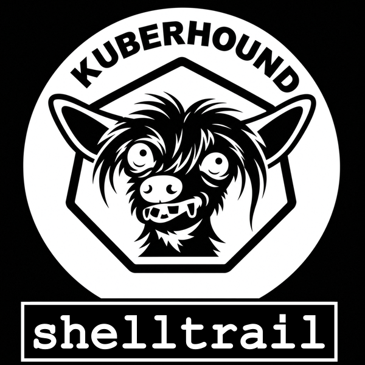

<p align="center"></p>

KuberHound collects Kubernetes resources and RBAC, maps attack paths, and imports them into [BloodHound](https://github.com/SpecterOps/BloodHound) as OpenGraph data.

## What it does

- Collects namespaces, nodes, pods, secrets (key names only, never values), configmaps, service accounts, roles, cluster roles, bindings, services, deployments, daemonsets, statefulsets and ingresses.
- Builds edges between them: who is bound to which role, what each role can do to which resource (`CAN_GET_SECRETS`, `CAN_CREATE_PODS`, ...), and which pods use which service accounts, secrets and configmaps.
- Adds attack edges: container escapes to the node, pod creation in namespaces without Pod Security enforcement, kubelet exec via `nodes/proxy`, ArgoCD and Fluentd abuse, and creating secrets/configmaps that pods reference but that don't exist yet.
- Adds privilege escalation edges, so BloodHound pathfinding can follow them: exec, attach and debug access to pods (`CAN_EXEC_PODS`, ...), becoming another service account by running a pod as it, minting a token or planting a token Secret (`CAN_RUN_POD_AS`, `CAN_CREATE_TOKEN`, `CAN_PLANT_TOKEN_SECRET`), impersonation (`CAN_IMPERSONATE`), binding or rewriting roles (`CAN_BIND`, `CAN_ESCALATE`), and legacy token Secrets (`CONTAINS_TOKEN`).
- Ships saved Cypher queries and custom node icons for BloodHound.

## Usage

```bash
pip install -r requirements.txt

# Uses in-cluster config or your current kubeconfig context
python3 kuberhound.py                                          # write kuberhound.json
python3 kuberhound.py -u http://localhost:8080 -k <API_KEY>   # upload to BloodHound
python3 kuberhound.py -u http://localhost:8080 -k <API_KEY> --upload-queries
```

Useful options:

| Option | Description |
|---|---|
| `--username` / `--password` | Log in to BloodHound instead of using an API key |
| `-r, --resources` | Collect only some resources, e.g. `-r rbac pods` (default: `all`) |
| `--default-psa` | Pod Security level for namespaces without an enforce label (default: `privileged`) |
| `--redact` | Mask potentially sensitive values before writing or uploading (see below) |
| `-i, --input` | Upload or redact an existing KuberHound JSON file instead of collecting |
| `--clear-database` | Clear the BloodHound database instead of collecting |

`query_bloodhound.py` runs a Cypher query against BloodHound from the command line, which is handy for debugging.

## The output is a map for compromising the cluster

KuberHound's output, both the JSON file and the data in BloodHound, shows exactly which identities can read which secrets, which pods can escape to their node, and which chain of permissions leads to cluster admin. That is what a defender needs to fix the cluster, and it is also step-by-step guidance for an attacker. Handle it like a credential: share it only with people who are allowed to attack the cluster, keep BloodHound off the network, and delete old exports when the assessment is done.

## Required permissions

KuberHound only reads from the cluster: it needs `list` on the resources below, cluster-wide. Running it with an admin kubeconfig works; for least privilege, bind this ClusterRole to the identity that runs the collector:

```yaml
apiVersion: rbac.authorization.k8s.io/v1
kind: ClusterRole
metadata:
  name: kuberhound-reader
rules:
- apiGroups: [""]
  resources: ["namespaces", "nodes", "pods", "secrets", "configmaps", "serviceaccounts", "services"]
  verbs: ["list"]
- apiGroups: ["rbac.authorization.k8s.io"]
  resources: ["roles", "clusterroles", "rolebindings", "clusterrolebindings"]
  verbs: ["list"]
- apiGroups: ["apps"]
  resources: ["deployments", "daemonsets", "statefulsets"]
  verbs: ["list"]
- apiGroups: ["networking.k8s.io"]
  resources: ["ingresses"]
  verbs: ["list"]
```

Note that `list` on `secrets` returns secret values to the collector. KuberHound discards them as soon as they are received and only exports key names. If `list` on `secrets` can't be granted, skip secrets with `-r`, e.g. `-r namespaces nodes pods configmaps rbac services deployments daemonsets statefulsets ingresses`. Pods referencing secrets then show them as missing nodes. If a resource can't be listed, the collector stops with a permission error; use `-r` to leave it out.

## Collecting on behalf of a tester

The tester doesn't need access to the cluster. A cluster admin can run the collector and hand over the JSON file, which the tester then imports into their own BloodHound:

```bash
# Cluster admin: collect without BloodHound, mask sensitive values
python3 kuberhound.py --redact -o kuberhound.json

# Tester: import the file with KuberHound's node icons and saved queries
python3 kuberhound.py -i kuberhound.json -u http://localhost:8080 -k <API_KEY> --upload-queries
```

The file can also be imported through the BloodHound UI (File Ingest), without icons and saved queries.

Secret values are never exported, with or without `--redact`. `--redact` additionally masks:

- annotation values on every object (keys are kept). Annotations can contain full manifests, e.g. ConfigMap contents in `kubectl.kubernetes.io/last-applied-configuration`
- Secret and ConfigMap key names
- Node IPs and hostnames, Service cluster and external IPs, and Ingress hosts

Object names, namespaces, labels, container images, RBAC rules, user and group names, and all security-relevant properties are kept, so every attack path and saved query works the same on redacted data. An existing file can be redacted afterwards with `python3 kuberhound.py -i kuberhound.json --redact -o kuberhound-redacted.json`.

## Running in the cluster

`deploy/kuberhound.yaml` runs BloodHound CE (with its PostgreSQL and Neo4j databases) and KuberHound together in the `kuberhound` namespace. A CronJob scans the cluster daily and uploads the result to that BloodHound, first clearing the previous graph (saved queries and Owned markers are kept) so deleted resources and revoked permissions don't linger.

**Keep in mind what this namespace contains:** BloodHound's database is a live, always up-to-date map of how to compromise the cluster, and the scanner's ServiceAccount can read every Secret in it. Anyone who can create pods, exec into pods or create tokens in `kuberhound`, or who gets access to BloodHound, effectively owns the cluster. Treat this namespace as the most sensitive one you have:

- Only cluster admins should have any access to the `kuberhound` namespace.
- Never expose BloodHound through an Ingress, LoadBalancer or NodePort; reach it with `kubectl port-forward`. A NetworkPolicy blocks traffic from other namespaces (if your CNI enforces NetworkPolicies).
- If secret key names aren't worth this risk, drop `secrets` from the ClusterRole and pass `-r` without it to the collector.

The BloodHound admin login is set when deploying, in the `kuberhound-bloodhound` Secret. BloodHound creates its admin account from it, and the scanner logs in with it.

Persistence is optional. By default BloodHound's databases use `emptyDir` volumes, so their data is lost whenever a database pod restarts. The admin account is then recreated from the Secret, the graph is refilled by the next scan and the saved queries are re-uploaded, but anything else changed in BloodHound (other users, Owned markers) is lost. To keep the data, also apply `deploy/persistence.yaml` and switch the `app-db` and `graph-db` Deployments to the volume claims, as described at the top of `deploy/kuberhound.yaml`.

Setup:

```bash
# 1. Build the image. The manifest expects it as kuberhound:local on the nodes; if you push
#    it to a registry instead, update "image:" and "imagePullPolicy:" in the CronJob
docker build -t kuberhound:local .

# 2. Deploy, and generate the database passwords and the BloodHound admin password
kubectl apply -f deploy/kuberhound.yaml
kubectl -n kuberhound create secret generic bloodhound-db \
  --from-literal=postgres-password=$(openssl rand -hex 24) \
  --from-literal=neo4j-password=$(openssl rand -hex 24)
kubectl -n kuberhound create secret generic kuberhound-bloodhound \
  --from-literal=username=admin --from-literal=password=$(openssl rand -hex 24)

# 3. Run a first scan instead of waiting for the schedule
kubectl -n kuberhound create job --from=cronjob/kuberhound kuberhound-first-scan

# 4. Log in at http://localhost:8080 as admin, with this password
kubectl -n kuberhound get secret kuberhound-bloodhound -o jsonpath='{.data.password}' | base64 -d; echo
kubectl -n kuberhound port-forward svc/bloodhound 8080:8080
```

Changing the admin password in the BloodHound UI breaks the scheduled scans. To change it, update the `password` in the `kuberhound-bloodhound` Secret to match.

The collector reads its BloodHound login from the `BLOODHOUND_URL`, `BLOODHOUND_USERNAME`, `BLOODHOUND_PASSWORD` and `BLOODHOUND_API_KEY` environment variables, so it never appears in the pod spec or process list. The same variables work outside the cluster.

## Attack paths

`attack-paths/` contains deliberately vulnerable lab scenarios for testing KuberHound. Each one has a manifest and a README explaining the attack, how to deploy it and how KuberHound detects it. Deploy them only in a throwaway cluster.

| # | Scenario |
|---|---|
| 01 | `list`/`watch` on secrets reveals their full contents, no `get` needed |
| 02 | Pod creation in a namespace without Pod Security enforcement leads to node takeover |
| 03 | `get` on `nodes/proxy` allows exec into any pod through the kubelet API |
| 04 | A `/var/log` host mount plus symlinks leaks node files through `kubectl logs` |
| 05 | Write access to secrets in the ArgoCD namespace gives code execution in the ArgoCD controller |
| 06 | The `bind` verb lets a subject bind itself to a more privileged role |
| 07 | `create` on `serviceaccounts/token` mints tokens for another service account |
| 08 | Creating a missing configmap that a pod waits for gives code execution in that pod |
| 09 | Editing a Fluentd configmap leaks the kubelet certificate through `kubectl logs` |
| 10 | `create` and `get` on secrets mints a token for any service account by planting a token Secret |

## License

Apache 2.0, see [LICENSE](LICENSE).
